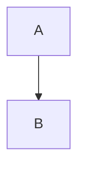

# caddy-diagrams

A Caddy v2 plugin that renders [goldmark-diagrams](https://github.com/frinknet/goldmark-diagrams)
fences into inline SVG. It serves standalone diagrams, renders markdown with
diagram support, and exposes the reference stylesheet as a standalone file or a
template helper.

Three surfaces, one renderer:

| Surface | Module ID | Use |
| --- | --- | --- |
| Handler directive | `http.handlers.diagram` | serve diagram sources, markdown, or CSS |
| Template extension | `http.handlers.templates.functions.diagram` | `{{ diagram }}`, `{{ diagramCSS }}`, `{{ diagramMarkdown }}` |
| Markdown renderer | (inside the handler) | injects the stylesheet once per page |

## Install

```sh
xcaddy build --with github.com/frinknet/caddy-diagrams
```

The repository also builds a scratch image tagged `caddy-diagrams:test` with
`./build.sh`. The image ships `www/` at `/srv/www` and starts there.

## Handler directive

```caddyfile
diagram [<matcher>] <type> [<path>] {
	root <dir>
	theme <auto|light|dark|neutral>
	error_mode <svg_card|code_block|fail>
	timeout <duration>
	d2_layout <dagre>
	languages <lang...>
}
```

`<type>` is one of:

- `auto` — detect the language from the file extension or source content.
- `mermaid`, `mmd`, `d2`, `plantuml`, `puml`, `dot`, `graphviz`, `chart`, `echarts` — a specific language.
- `markdown` — render a markdown document with diagram support.
- `css` — serve the reference stylesheet.

`<path>` is optional. Without it, the handler matches:

- `css` at `/_diagrams/diagrams.css`
- `markdown` at `*.md`
- diagram languages at known source extensions (`.mmd`, `.mermaid`, `.d2`, `.puml`, `.plantuml`, `.dot`, `.gv`, `.graphviz`, `.chart`, `.echarts`)

With it, the handler matches that path exactly, as a prefix when it ends in `/`,
or as a glob when it contains `*`.

A typical route puts the handler ahead of `file_server`:

```caddyfile
:80 {
	root * /srv/www

	handle /_diagrams/diagrams.css {
		diagram css
	}

	handle /flow.mmd {
		diagram auto
	}

	handle /page.md {
		diagram markdown
	}

	handle {
		file_server
	}
}
```

### CSS delivery

The reference stylesheet is delivered in three ways:

- **Independent file.** `diagram css` serves the raw stylesheet as `text/css`.
- **Template.** `{{ diagramCSS }}` or `{{ diagram "css" "" }}` returns a `<style>` block. Put it once in the page head.
- **Markdown.** `diagram markdown` prepends the stylesheet to the rendered HTML once, and only when a diagram is present.

Standalone diagram and markdown responses embed the stylesheet in the page, so
they render without a separate request.

## Template extension

```caddyfile
templates {
	extensions {
		diagram {
			theme dark
			error_mode fail
		}
	}
}
```

Then, in a template:

```html
<head>{{ diagramCSS }}</head>
<body>
  {{ diagram "mermaid" "flowchart TD\n  A --> B" }}
  {{ diagram "auto" "digraph { a -> b }" }}
  {{ diagramMarkdown "# Rendered markdown" }}
</body>
```

`{{ diagram <type> <body> }}` renders a standalone figure. `auto` detects the
language from the body. `css` returns the stylesheet. `markdown` renders the body
as markdown with diagram support.

## Markdown

The handler's `markdown` type renders fenced blocks in the supported languages:

````markdown

````

The stylesheet is inserted once at the top of the response. Fences in other
languages are left as ordinary code blocks.

## Options

All options are available in the handler block and the template extension block:

| Option | Default | Notes |
| --- | --- | --- |
| `theme` | `auto` | `auto`, `light`, `dark`, or `neutral` |
| `error_mode` | `svg_card` | `svg_card`, `code_block`, or `fail` |
| `timeout` | `5s` | per-render timeout |
| `d2_layout` | `dagre` | only `dagre` is accepted |
| `languages` | all | restrict which fences are intercepted |

## Build and test

All Go tooling runs in the builder container. Do not use the host toolchain.

```sh
sh test/unit.sh       # gofmt, go vet, go test
./build.sh            # build caddy-diagrams:test
sh test/e2e.sh        # run the image against the fixtures
```

The e2e suite compares response bodies byte for byte with
`test/e2e/fixtures/expected/`. Regenerate those files after an intentional
output change:

```sh
E2E_UPDATE=1 sh test/e2e.sh
```

The race detector needs cgo:

```sh
docker run --rm -v caddy-sf-mod:/mod -v "$PWD":/src -w /src \
  -e GOMODCACHE=/mod -e GOCACHE=/mod/gocache -e CGO_ENABLED=1 \
  caddy:2.11.9-builder-alpine \
  sh -c 'apk add --no-cache gcc musl-dev && go test -race -timeout=180s ./...'
```

## Renderer dependency

The renderer is the upstream
[`goldmark-diagrams`](https://github.com/frinknet/goldmark-diagrams) module,

`xcaddy` builds the plugin as a dependency, and Go ignores `replace` directives
from dependency modules, so the image build passes the same mapping explicitly:

```sh
xcaddy build \
  --with github.com/frinknet/caddy-diagrams \
  --replace github.com/frinknet/caddy-diagrams=/src \
```

To upgrade the renderer, bump the `require` version, run
`go mod tidy` in the builder container, then run `sh test/unit.sh`, `./build.sh`,
and `sh test/e2e.sh`.

## License

Apache-2.0. See `LICENSE` and `NOTICE`.
