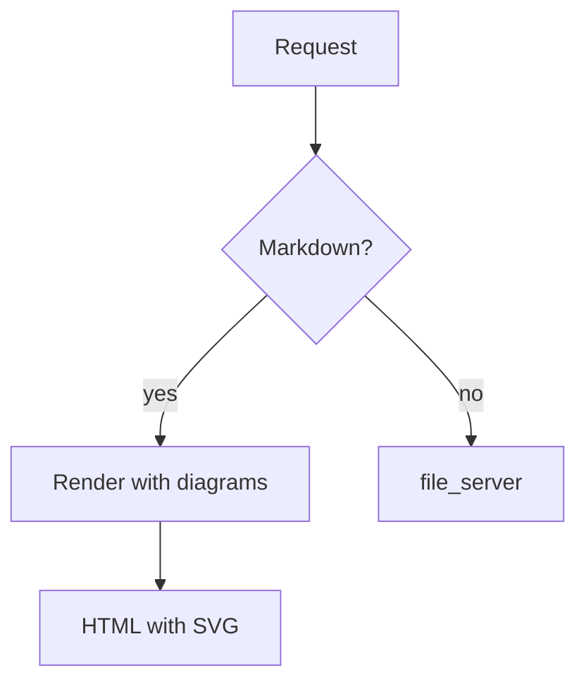

# caddy-diagrams demo

This page is rendered by the `diagram markdown` handler. The stylesheet is
injected once at the top of the page.

The standalone diagram is served at `/flow.mmd` and the stylesheet at
`/_diagrams/diagrams.css`.
